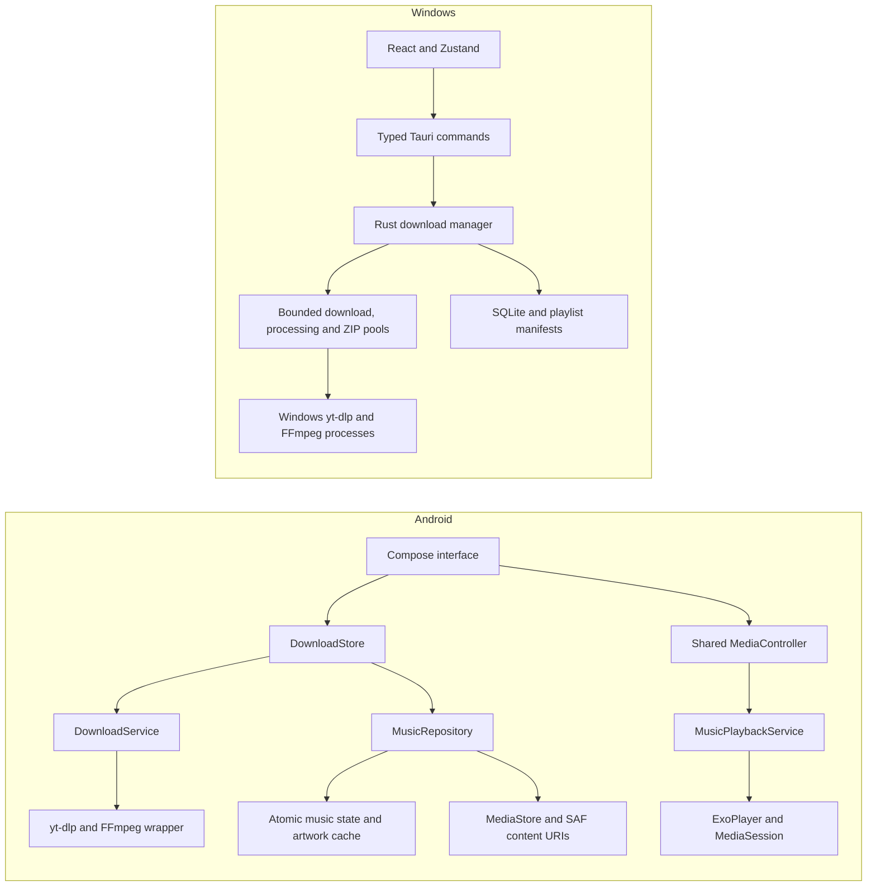

# YTHub architecture

YTHub contains two independently implemented native applications. The shared boundary is product behavior and branding, not a common runtime or cross-platform database. This guide describes the implemented structure; platform acceptance results belong in the dated audit reports.

## System boundaries

There is no hosted YTHub service. Online extraction/download requests use external media services. Files, preferences and application state remain local. Browser preview exposes the frontend without native media operations.

## Android

### Presentation and navigation

`MainActivity.kt` composes four primary destinations: Home, Downloads, Library and Settings. Playback, media details and secondary settings are contextual destinations. Navigation retains per-destination Compose state and tracks the originating screen for Back/minimize behavior.

`MusicDesign.kt` owns common surfaces, typography and sheet actions. `MobileMotion.kt` defines finite motion, download stage/progress presentation and occurrence keys for repeated tracks. `GlassNavigationBar.kt` renders navigation glyphs and the recorded backdrop through Android's native blur where supported. Scrolling content draws beneath the translucent navigation/mini-player; measured bottom padding keeps the final controls and rows reachable. Player and keyboard layouts apply their own system-safe insets.

`MusicScreens.kt`, `NowPlayingScreen.kt`, `PlayerSettingsScreen.kt` and `PlayerControls.kt` observe runtime state. UI animations never create a playback engine, invent download progress or write a position checkpoint on every animation frame. Native Slider semantics are retained for seeking and media volume.

### Download ownership

`DownloadStore.kt` owns task records, preferences, queue coordination, native extractor requests and export references. `DownloadService.kt` keeps supported active work in a foreground service. Download history is saved to `downloads.json` through a synchronized temporary-file replacement; download preferences use SharedPreferences. Unfinished active/queued work restores as Interrupted and requires explicit resume.

The Android pipeline is:

1. Validate and analyze the supplied media URL.
2. Queue the media with a snapshot of download options.
3. Download/process in an isolated per-job working directory.
4. Export through MediaStore or the selected SAF destination.
5. Publish recorded output URIs and the final task state.
6. Reconcile successfully completed audio into the music library according to preferences.

Failed/partial tasks are not automatically indexed as completed tracks. Video and ZIP outputs are not audio tracks. Explicit archive import is a separate transaction.

### Music repository and identity

`MusicRepository.kt` owns metadata, playlists, favorites, recent listening, settings, queue restoration data and import reconciliation. URI-derived IDs prevent repeated scans of the same output from creating duplicate tracks. Playlist order and repeated occurrences are preserved separately from library identity.

`MusicPersistence.kt` validates saved state and performs additive schema migration. The historical `music/library-v1.json` filename is retained even though the payload supports the newer schema. Android AtomicFile protects replacement; a serialized, conflated IO writer suppresses redundant persistence. Invalid/future state is preserved and reported rather than overwritten silently.

`DeviceMusicPicker.kt` queries Android's shared audio index after runtime permission is granted. A ContentObserver refreshes the list when phone music changes. Adding an existing phone track retains its original URI and source file. SAF grants are used for document-provider imports.

Artwork is bounded to a 64MiB disk cache. Metadata filtering and repository IO run on worker dispatchers. Large song/queue views are lazy, search is debounced, and derived indexes are memoized.

### Playback ownership

`MusicPlaybackService.kt` owns the single ExoPlayer and MediaSession. Compose screens and system media commands use the shared controller. The native service handles audio focus/noisy routes, supported background playback, queue transitions, repeat/shuffle, playback speed, sleep deadlines and available session-scoped audio effects.

A 500ms UI snapshot tick does not imply a disk write. Queue/position checkpoints occur approximately every five seconds and on significant transitions, so abrupt process death may lose the most recent interval. Restoration prepares paused playback rather than unexpectedly starting audio. Sleep deadlines use elapsed real time and do not survive process termination.

### Storage and file safety

- Public exports use pending MediaStore entries where supported; SAF exports use the user's persisted grant.
- The library stores content URI references. Library removal and source-file deletion are separate operations.
- Destructive deletion requires confirmation and must be permitted by the source provider.
- ZIP extraction uses a fresh private destination, rejects unsafe/duplicate paths, enforces size/entry limits and rolls back failed imports. Indexing follows successful extraction.
- FileProvider grants access to app-owned media without exposing arbitrary filesystem paths.

## Windows

### Presentation and command boundary

React/TypeScript renders native state and compact progress patches through Zustand. It has no generic shell or filesystem permission. `src-tauri/src/main.rs` exposes explicit commands for queue management, history, settings, diagnostics and native file actions. Media bytes do not pass through React.

### Scheduler and processing

The Rust manager coordinates reusable download, processing and ZIP pools through bounded channels, semaphores, cancellation tokens, resource budgets and a short-lived process table. Playlist metadata is staged in compact disk manifests; only a bounded window becomes full jobs.

Windows Job Objects own subprocess trees. Engines receive argument arrays rather than interpolated shell strings. Validated paths, canonical output checks and atomic final-file publication protect the file boundary. Provisioned tool versions/digests are recorded separately from ignored executable resources.

### Persistence and recovery

SQLite is the durable queue/history, with compact manifests and retained staged media. Completed jobs leave the live window without disappearing from durable history. Active work restores as interrupted; legacy state migration preserves its source. Settings include local paths and are not encrypted.

See [download-engine.md](download-engine.md), [concurrency.md](concurrency.md), [reliability.md](reliability.md) and [recovery.md](recovery.md) for detailed operational behavior.

## Extension rules

1. Keep player lifetime in the native service and media work behind the platform command/repository boundary.
2. Derive UI from actual task/player state; never mark processing or partial output as completed for presentation purposes.
3. Preserve track IDs, playlist occurrences, exported URIs and migration compatibility.
4. Index imports only after successful publication/extraction; keep removal separate from file deletion.
5. Bound caches, queues, list composition and IO. Avoid persistence from per-frame UI updates.
6. Preserve permission-denied, missing-file, unsupported-effect and interrupted-work states.
7. Record what was tested on a device, emulator, generated fixture or real network source separately.

## Validation and known limits

Frontend checks are ESLint, TypeScript/Vite and Vitest. Android adds Gradle builds, JVM tests, lint and installed instrumentation. Windows native checks use Rust format/Clippy/tests and packaging validation on Windows. The CI workflows do not replace physical Android acceptance.

The Android implementation has real native background-media configuration, but exhaustive lock-screen, Bluetooth/headset, interruption and OEM battery-policy acceptance is incomplete. Crossfade/virtualizer/normalization are unavailable. Effects and decoder capabilities vary by device. UI frame samples contain slow frames; no sustained frame-rate guarantee is established. Production signing is configured by the publisher, and there is no iOS target.

Evidence: [music integration audit](MUSIC_PLAYER_AUDIT.md), [UI/motion audit](UI_COMPACT_AUDIT.md), [Windows verification](verification.md).
